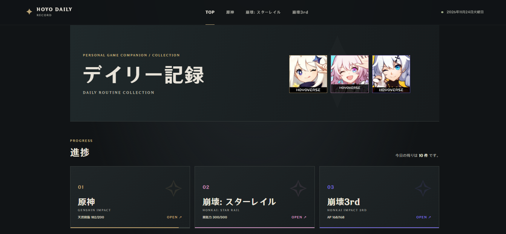
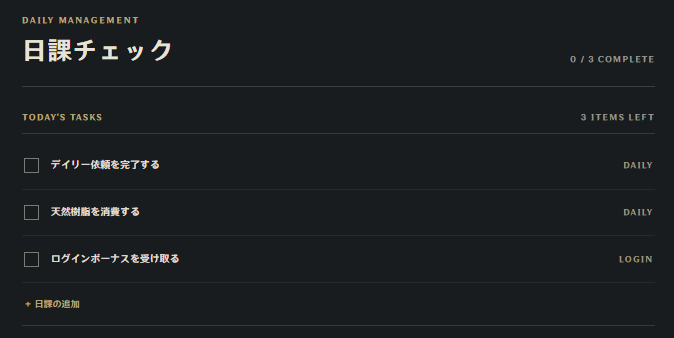
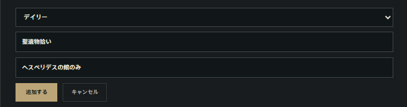
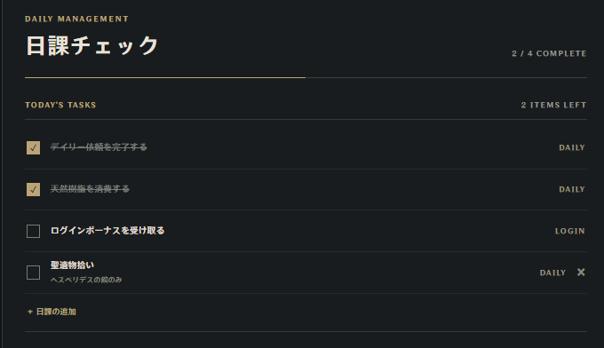
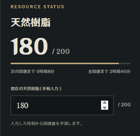
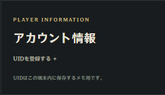
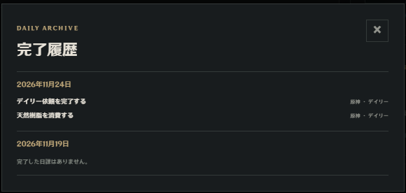

# HOYO DAILY

## こちらから開けます↓
https://damusama.github.io/hoyo-daily/

## 概要
原神・崩壊：スターレイル・崩壊3rd向けの、ゲーム別日課・リソース管理アプリです。複数タイトルの日課をひとつの画面にまとめ、今日やることやスタミナの状態を確認できます。  

## 主な機能

- TOPで3タイトルの日課とリソース状況を一覧表示し、全ゲームの進捗を確認
- タイトルごとに日課の完了状態をチェック

- 自分用に日課を追加 ログイン／デイリー／ウィークリーの種類を選んで内容とメモを追加できる 

    ↓　追加される（削除可能）  
   
- 天然樹脂・開拓力・APの値を手入力し、入力時刻を基に回復量と全回復までの時間を予測

- UIDを端末内のメモとして保存 
 
- TOOLSからモーダルで日付ごとの完了履歴を確認（ゲーム・日課の種類・日課名を表示）
- 日課、リソース、UIDをブラウザのlocalStorageに保存
- 日付をまたいでアプリを開いたとき、前日の完了状況を履歴に記録してチェックをリセット（履歴は直近60日分）
 

## コンセプトと工夫

複数のゲームを並行して遊ぶと、タイトルごとにログイン報酬やデイリー任務、スタミナの確認先が分かれてしまいます。このアプリでは3タイトルを一つの画面に集約しつつ、一覧から各タイトルの詳細へ移動できるようにしました。

日課の種類とゲームを一括もしくは分けて記録でき、初めのテンプレだけでなく自分の遊び方に合わせた項目も追加できます。また、UIDを一時保存できる場所の作成や、現在のスタミナを入力しておくと、入力値と入力時刻を使い全回復までの時間を予想できるような機能にしました。

## 使用技術

- React 19
- TypeScript
- Vite
- Tailwind CSS 4（Viteプラグイン）
- GitHub Pages（デプロイ設定）

## 注意事項

データは利用中のブラウザのlocalStorageに保存されます。ブラウザデータを消去すると記録も消え、別の端末やブラウザには同期されません。

初期の日課はサンプルです。ゲーム内の実際の日課・リセット時刻とは連動していません。ウィークリーは項目の分類として選択できますが、週単位の自動リセットには対応していません。スタミナは全回復すると計算も止まるため、定期的に入力が必要です。日付変更後のチェック状態と履歴は、アプリを次に開いたときに更新されます。

## 開発情報

開発期間: 2026.10.23 ~ 2026.11.19 (約20時間) 
